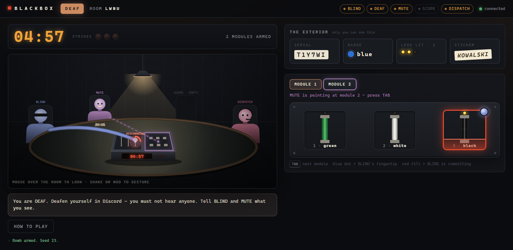
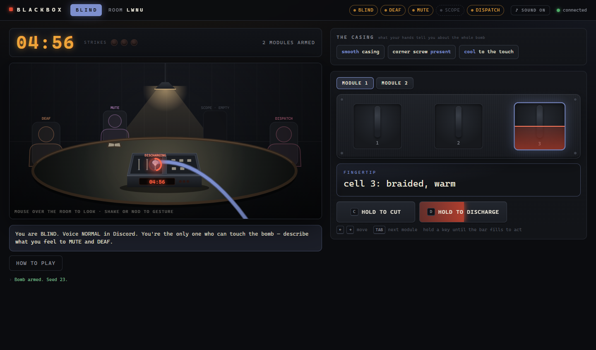
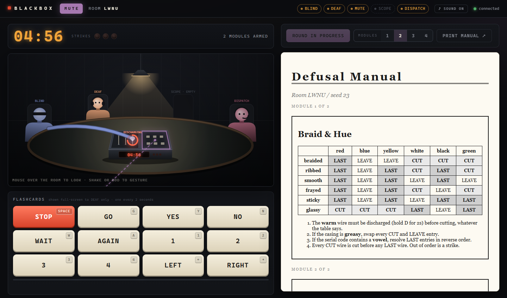

<h1 align="center">B L A C K B O X</h1>

<p align="center"><b>One bomb. Three players around one table. Nobody has the whole picture.</b></p>

BLACKBOX is an asymmetric co-op bomb-defusal game for 3–5 players. It runs in the browser, and voice
runs on Discord. Everyone sits around one virtual table with one bomb in the middle. You can watch each
other look, nod and point (except BLIND, who only senses silhouettes) — but the bomb itself looks
different to each of you.

|           | Can                                          | Can't                                                       |
|-----------|----------------------------------------------|-------------------------------------------------------------|
| **BLIND** | touch the bomb — the only one who can act    | see it                                                      |
| **DEAF**  | see every colour, number and light           | hear anyone (deafened in Discord)                           |
| **MUTE**  | hear everyone, and read the generated manual | speak (muted in Discord) — only nod, shake, point and flash cards |



<sub>The same moment from DEAF's seat: BLIND's arm is on the black wire, and the red ring means they
are holding to act on it. MUTE's dashed pointer is on module 2.</sub>

<table>
  <tr>
    <td width="50%"></td>
    <td width="50%"></td>
  </tr>
  <tr>
    <td><sub><b>BLIND</b> gets a featureless shell and silhouettes. All they have is what their fingertip
      feels: <i>braided, warm</i>.</sub></td>
    <td><sub><b>MUTE</b> has the manual and the flashcards. They know the warm wire has to be discharged
      first — and can't say so.</sub></td>
  </tr>
</table>

## The ring

Nobody can talk to everyone, so information has to travel round a ring:

```
BLIND ──voice──▶ MUTE ──nods & flashcards──▶ DEAF ──voice──▶ BLIND
```

MUTE hears everyone, so MUTE usually works out the answer first — and is the only one who can't say
it. Everything BLIND commits to is a hold (one second, two to discharge) that everyone watches fill
as a red ring on the bomb. That second is MUTE's window to slam **STOP**.

There is no text chat, on purpose: one typed sentence would collapse the whole game.

## Playing

1. Start the server (see [Running it](#running-it)) and open <http://localhost:8000>.
2. **Create a room** and send each friend their seat's link.
3. In Discord, **DEAF deafens and MUTE mutes**. BLIND talks normally.
4. Once BLIND, DEAF and MUTE are in, MUTE picks how many modules (1–4) and arms the bomb.
5. Solve every module (needy ones just need tending) before the five-minute timer runs out. Three
   strikes and it detonates.

### Controls

| Who          | How |
|--------------|-----|
| **BLIND**    | `←` `→` move your fingertip (on a gauge they turn the knob) · `Tab` next module · hold the key shown on a button (or the button itself) until its bar fills: `C` cut, `D` discharge, `P` press/stamp, `K` skip, `V` purge, `L` lock in, `H` confirm. Moving mid-hold cancels it. |
| **DEAF**     | `Tab` next module. MUTE's flashcards appear full-screen. |
| **MUTE**     | `Space` STOP · `G` GO · `Y` YES · `N` NO · `W` WAIT · `A` AGAIN · `1`–`4` · `←` `→` LEFT/RIGHT. One card every two seconds, shown to DEAF only. Click a module to point at it. |
| **Everyone** | Move the mouse over the room to look around. Wiggle it side to side to shake your head, up and down to nod. Look down and your eyes drop — when MUTE does it, their lectern lights up so DEAF can see MUTE is reading. |

BLIND never sees anyone's face, gestures or pointing — only silhouettes that pulse when someone moves.
That's deliberate: if MUTE could signal BLIND directly, the ring would collapse.

### Optional seats

| Role         | Discord  | Sees |
|--------------|----------|------|
| **SCOPE**    | Muted    | the internal wiring only, and listens in |
| **DISPATCH** | Voice on | the timer and strikes, nothing inside — talks to BLIND |

## Modules

Every bomb is built from a random seed, and so is its manual, so the rules change every round.

| Module                      | BLIND feels                                | DEAF sees                                | MUTE's manual has |
|-----------------------------|--------------------------------------------|------------------------------------------|-------------------|
| **Braid & Hue**             | each wire's texture, and which one is warm | wire colours, and which wire feeds the LED | a texture × colour table of CUT / LEAVE / LAST |
| **The Ledger**              | a number on each tile                      | a different printed number on each tile  | a number × number table of PRESS / SKIP |
| **Gauge & Detents**         | the knob clicking as they turn it          | where the needle points                  | the target zone |
| **The Manifest**            | a symbol on each stamp                     | a letter on each stamp                   | a symbol × letter table giving the press order |
| **The Static**              | which tiles buzz                           | tile colours and the lit LEDs            | the rule comparing the buzz count to the LEDs |
| **The Vent** *(needy)*      | which vent is warm                         | which vent glows                         | which vent to purge — within 15 seconds, about every 45 |
| **The Handshake** *(needy)* | whether the port is syncing                | the sync light and the sticker           | whether to confirm each sync or let it pass |

Edge flags — the casing, how warm it feels, a missing corner screw, the serial number, the badge
colour, the sticker — bend those rules, so the team has to compare notes before anyone touches
anything.

## Running it

Needs Python 3.10 or newer.

```bash
python -m venv .venv
.venv\Scripts\activate            # Windows; on macOS/Linux: source .venv/bin/activate
pip install -r requirements.txt
python -m uvicorn server.main:app --port 8000
```

Then open <http://localhost:8000>. To play with friends on your network, add `--host 0.0.0.0` and
share your machine's address. To play over the internet, put the server behind a tunnel such as
Cloudflare Tunnel; on https the client switches to secure websockets automatically.

To test alone, `python tools/devroom.py` creates a room and opens the BLIND, DEAF, MUTE and SCOPE
pages in browser tabs.

## Tests

```bash
python -m pytest tests
```

The two that matter most: `tests/test_invariants.py` checks that no role ever receives another
role's perception, and `tests/test_presence.py` checks that BLIND never receives anyone else's head
pose, gestures or pointer. Every module also has its own testbench, run across hundreds of random
seeds.

## How it's built

- **Server**: FastAPI and WebSockets, and fully authoritative. Every rule lives in Python, and each
  role gets a payload filtered for it on the server — nothing is sent and then hidden in the browser.
- **Client**: plain HTML, CSS and ES modules, with no framework, no build step and no dependencies.
  The room is a 2D canvas diorama (`client/common/stage.js`).
- **Three channels**: WORLD (geometry, shared by everyone), PRESENCE (bodies, filtered per role) and
  PERCEPTION (properties, never shared). *Structure and bodies are shared. Properties are not.*
- **Modules**: adding one means dropping a file into `server/modules/` with an `@register`
  decorator — no engine changes.

[`AGENTS.md`](AGENTS.md) is the engineering contract and ticket backlog;
[`bomb_game_design_doc.md`](bomb_game_design_doc.md) is the design rationale.
